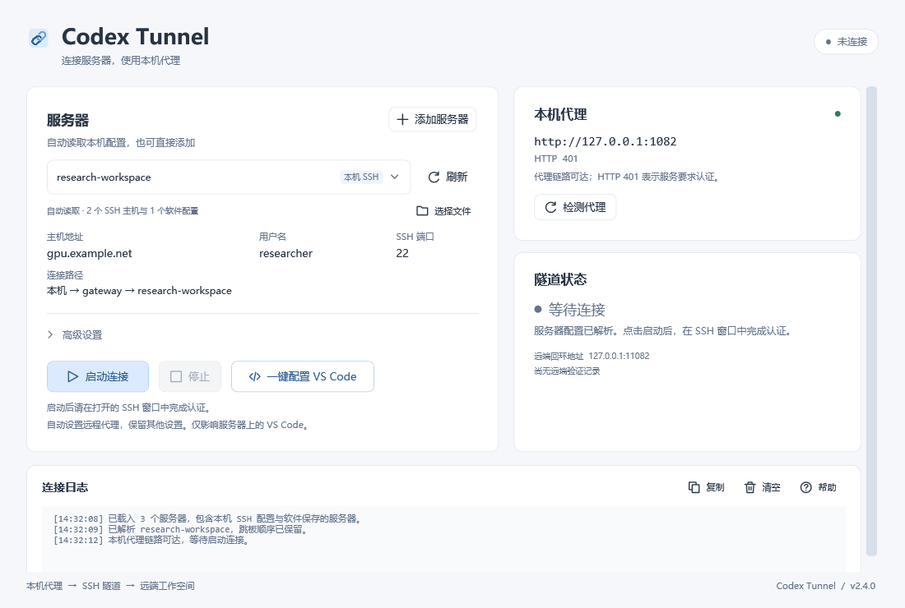

# Codex Tunnel

**让无法直接联网的 Linux 服务器，通过 Windows 电脑上的代理使用 VS Code 远程 Codex 扩展。**

[下载最新版 EXE](https://github.com/qwe123ew/codex_Tunnel/releases/latest) · [新电脑配置步骤](VSCode-快速配置.md) · [常见问题](docs/TROUBLESHOOTING.md) · [完整说明](read.md) · [MIT 许可证](LICENSE)

在 Releases 页面下载 `CodexTunnel-v2.4.exe`，双击即可运行。**EXE 已包含运行脚本，无需解压源码包，也无需在 Windows 上安装 Python 或 Node.js。**

| 发布文件 | 用途 |
|---|---|
| `CodexTunnel-v2.4.exe` | 直接运行的软件 |
| `CodexTunnel-v2.4-portable.zip` | EXE、中文使用说明和许可证，适合整体复制给别人 |
| `CodexTunnel-v2.4.0-source.zip` | 源码、文档、测试和 EXE，供开发或查阅 |
| `SHA256SUMS.txt` | 上述文件的 SHA-256 校验值 |

提取或下载 EXE 后，删除 ZIP 不影响程序使用。

这是独立的社区工具，与 OpenAI、Microsoft 无隶属关系。它建立 SSH 代理隧道，不附带 Codex，不提供模型或 API 服务，也不把本地 Codex 变成远程 API。Codex 扩展在远程服务器上运行，账号登录与使用权限由官方客户端和服务决定。



*界面使用演示数据，展示操作布局，不代表已连接到某台真实服务器。*

## 能做什么

- 自动读取当前电脑的 SSH 配置，以及 VS Code / Insiders 指定的 SSH 配置和客户端。
- 下拉选择服务器，保留原有认证选项、密钥和跳板路线；没有配置时提供填写引导。
- 自动寻找并检测本机 HTTP / Mixed 代理，也支持手动填写端口。
- 一键启动、停止 SSH 反向隧道，分别显示本机代理与远端连接状态。
- 点击 **一键配置 VS Code**，设置远端代理并备份原文件，无需手动编辑 JSON。

## 使用前准备

| 位置 | 要求 |
|---|---|
| Windows 电脑 | Windows 10/11、.NET Framework 4.8、Windows PowerShell 5.1、OpenSSH 客户端、`curl.exe` |
| 本机代理 | 已启用本机回环地址上的 HTTP / Mixed 监听，且能访问目标服务 |
| Linux 服务器 | 当前电脑能通过 SSH 登录；SSH 服务允许反向端口转发；有 `sh`，自动网络检测需要 `curl` |
| VS Code | 本机安装微软 **Remote - SSH**；先成功连接目标服务器一次，以部署 VS Code Server |
| Codex | 远端安装发布者为 OpenAI 的官方扩展，并按其提示登录 |

软件不自动下载缺失组件。纯 SOCKS、PAC、TUN 或需要账号密码的代理入口不在自动支持范围内，请在代理软件中启用 HTTP / Mixed 端口；无需开启“允许局域网连接”。

当前 EXE 未做商业代码签名。请从本仓库 Releases 获取文件，并遵循所在电脑或组织的应用运行策略。

发布页提供 `SHA256SUMS.txt`。下载后可在 PowerShell 中执行以下命令，并与清单中同名文件的 SHA-256 比较：

```powershell
Get-FileHash -Algorithm SHA256 .\CodexTunnel-v2.4.exe
```

## 第一次使用

### 1. 打开代理，选择服务器

先打开本机代理软件，再运行 EXE。已有 VS Code Remote - SSH 连接的电脑，在下拉框选择同一服务器；若存在 VS Code 来源的条目，优先使用它。

没有配置时，直接点击 **启动连接**，按表单提示填写后选择 **保存并连接**；也可以点击 **添加服务器**，仅保存资料。

| 字段 | 填写内容 |
|---|---|
| 名称 | 自己容易识别的名字，例如“实验室服务器” |
| 服务器地址 | 管理员提供的 IP 或域名，例如 `gpu.example.org`；不填整条 SSH 命令 |
| 用户名 | 服务器登录账号，不一定等于 Windows 用户名 |
| SSH 端口 | 默认 `22`；有特殊配置时填写实际端口 |
| 私钥 | 密钥登录时选择已有私钥文件；密码登录时留空 |
| 跳板机 | 需要中转时添加，按从本机到目标的顺序填写；最多四台 |

**软件读取已有连接资料，不凭空推断未知服务器的地址或账号。表单只保存连接参数和私钥路径，不保存密码、验证码或私钥内容。**

### 2. 启动隧道并完成 SSH 认证

点击 **启动连接**，程序会先检测代理。随后在新打开的 SSH 窗口输入密码、验证码，或按正常 SSH 流程核对主机指纹。密码输入时不显示字符是正常现象。

等待主窗口显示 **远端代理已就绪**。使用期间保持软件、代理和隧道认证窗口打开。点击 **停止** 结束本软件创建的隧道。

“高级设置”中，本机代理端口留空即可自动检测；远端代理端口默认为 `11082`。这两个端口可以不同。

### 3. 用 VS Code 连接同一服务器账号

在本机 VS Code 按 `Ctrl+Shift+P` → **Remote-SSH: Connect to Host...**，使用与软件一致的服务器和账号。首次连接会部署 VS Code Server；受限环境需要按所在单位的方式完成部署。

软件自己保存的服务器不会写入 `.ssh/config`，因此不会自动变成 VS Code 的服务器列表。没有 VS Code 入口时，可用 **Remote-SSH: Add New SSH Host...** 按提示添加：

```text
ssh -p 22 user@gpu.example.org
```

有跳板机时，例如：

```text
ssh -J jumpuser@jump.example.org:22 -p 22 user@gpu.example.org
```

替换上述示例中的账号、地址和端口。这是你在 VS Code 中添加连接入口，不是隧道程序修改本地配置。

### 4. 点击“一键配置 VS Code”

回到 Codex Tunnel，点击 **一键配置 VS Code**。它使用独立 SSH 会话，可能再次要求认证；已有隧道继续运行。

配置成功后，回到 **VS Code 远程窗口**，按 `Ctrl+Shift+P` → **Developer: Reload Window**。按钮自动写入的远程设置为：

```json
{
  "http.useLocalProxyConfiguration": false,
  "http.proxy": "http://127.0.0.1:1102"
}
```

无需复制这段 JSON；实际端口自动取自软件设置。程序保留其他设置、注释和尾随逗号，修改前备份；相同值不会重复写入。它复用服务器已有的 VS Code Node 运行时，不下载运行时。

配置只作用于所识别的远端 VS Code Server 安装，包括已识别的稳定版和 Insiders。**同一服务器账号的远程设置会被该账号的 VS Code 窗口共享**，不按电脑分别保存。

### 5. 安装并登录远端 Codex

在 VS Code 扩展面板搜索 `@id:openai.chatgpt`，确认发布者 **OpenAI**，选择 **Install in SSH: 当前服务器**。然后打开 Codex，按官方扩展提示完成登录。

可发送“运行 pwd 并列出当前目录，不修改文件”进行实际检查。软件不会自动登录账号，也不需要复制本地 Codex 配置或登录文件。

## 网络路线与状态

```text
远程 Linux 中的 Codex 扩展
  → 服务器 127.0.0.1:11082
  → SSH 加密反向隧道（可经过跳板机）
  → Windows 本机 HTTP / Mixed 代理
  → 目标服务
```

| 结果 | 表示什么 |
|---|---|
| 本机代理检测通过 | Windows 通过代理完成目标 HTTPS 请求；尚不能证明服务器链路可用 |
| 远端代理已就绪 | 服务器通过隧道完成目标 HTTPS 检测 |
| 远端状态未验证 | 缺少远端 `curl` 或未收到及时的检测结果，不能继续视为成功 |
| VS Code 配置成功 | 远程设置已保存；仍需重新加载窗口并完成 Codex 登录 |

检测请求不携带 OpenAI 凭据。HTTP `401` 是预期的未认证响应，表示本次网络请求到达服务，**不表示账号已登录或模型调用可用**。仅有 `200 Connection established` 不能证明 TLS 和后续 HTTPS 请求成功。

关闭代理、Windows 休眠或网络断开后，服务器会失去这条网络路径。恢复后重新启动隧道；软件不会自动反复提交密码。

## 配置保存在什么地方

| 内容 | 位置与处理方式 |
|---|---|
| 软件保存的服务器 | `%LOCALAPPDATA%\CodexProxyTunnel\servers.json` |
| 当前连接快照 | 同目录 `gui-profile.json` |
| 本机 SSH 来源 | `%USERPROFILE%\.ssh\config` 及支持的 `Include`，只读 |
| VS Code 指定的 SSH 配置 | 读取 VS Code / Insiders 默认用户设置中的 `remote.SSH.configFile`、`remote.SSH.path` |
| 远端代理设置 | 仅点击配置按钮时，更新所识别远端安装的 `data/Machine/settings.json` 或其自定义用户数据目录 |
| 远端备份 | 原设置同目录的 `settings.json.codex-tunnel-backup-*` |

程序不修改本地 Codex、VS Code、全局 SSH 或系统代理设置。正常 SSH 认证仍可能按照 OpenSSH 的行为记录已确认的主机指纹。远端配置不会修改项目 `.vscode/settings.json`、Shell 启动文件或 Codex 配置。

复制给别人时，只需发送发布 EXE 和使用说明，**不要附带自己的 AppData、SSH 配置、私钥或登录文件**。发行包不含个人服务器、密码、私钥或登录凭据。

自动读取不覆盖所有第三方终端、便携版 VS Code 和任意自定义数据目录。找不到已有配置时使用 **选择文件**。出于明确的解析边界，`Match exec`、网络共享配置路径等不支持；错误提示见[常见问题](docs/TROUBLESHOOTING.md)。

## 从源码构建

在仓库根目录运行以下 **Windows PowerShell 5.1** 命令：

```powershell
powershell.exe -NoProfile -ExecutionPolicy Bypass -File .\gui\Build-Gui.ps1
```

输出为 `dist\gui\CodexTunnel.exe`。构建使用系统 .NET Framework C# 编译器和 WPF，不依赖 .NET SDK、NuGet 或在线下载。这里的 `-ExecutionPolicy Bypass` 仅用于该构建进程，不修改系统的持久执行策略；组织策略禁止时应使用其允许的构建方式。

主要目录：

```text
gui/                       WPF 界面、后端、图标和构建脚本
Start-Tunnel.ps1            隧道与远端配置的执行入口
SshImport.ps1               SSH 来源发现、解析与独立连接快照
ProxyTools.ps1              本机代理发现与 HTTPS 检测
remote-monitor.sh          远端网络与心跳检查
remote-vscode-config.*     远端 VS Code 设置发现、备份与更新
tests/                     自动化测试
docs/                      公共说明与界面图片
VSCode-快速配置.md           面向首次使用者的逐步说明
read.md                    完整 GUI / 控制台 / 脚本说明
```

例如，可在构建后运行以下隔离验证：

```powershell
powershell.exe -NoProfile -ExecutionPolicy Bypass -File .\tests\test_native_ssh.ps1
powershell.exe -NoProfile -ExecutionPolicy Bypass -File .\tests\test_vscode_launcher.ps1
powershell.exe -NoProfile -ExecutionPolicy Bypass -File .\tests\test_vscode_action.ps1 -BackendAssembly .\dist\gui\CodexTunnel.exe
powershell.exe -NoProfile -ExecutionPolicy Bypass -File .\tests\test_gui_package.ps1 -Executable .\dist\gui\CodexTunnel.exe
```

远端 JSONC 更新测试需要开发机已有 Python 3 和 Node.js；部分 shell 集成测试还使用已有 Git Bash。这些是测试依赖，不是发布 EXE 的运行依赖：

```powershell
python -m unittest discover -s tests -p test_remote_vscode_config.py -v
```

隔离测试验证配置更新、认证进程管理和打包行为；不代替实际服务器认证、Codex 登录或模型调用验证。

## 反馈问题

请先查看[常见问题](docs/TROUBLESHOOTING.md)。提交 [Issue](https://github.com/qwe123ew/codex_Tunnel/issues) 时附上软件版本、Windows / VS Code 版本、失败阶段和脱敏日志；不要上传密码、令牌、私钥或完整个人 SSH 配置。

## 许可证

项目采用 [MIT License](LICENSE)。可以按许可证使用、修改和分发；重新分发时保留版权声明和许可证文本。项目按原样提供，不承诺所有 SSH 客户端、服务器策略或未来 Codex 扩展版本均兼容。
